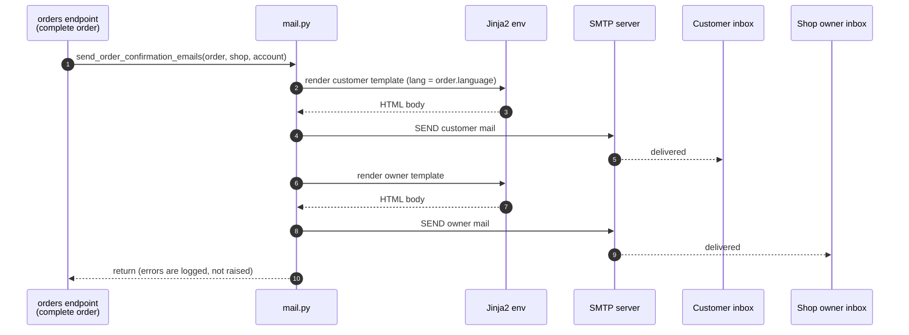

# Email notifications

Transactional email is rendered with Jinja2 and sent via SMTP.

## Implementation

- **Entry point:** `server/mail.py`.
- **Templates:** `server/mail_templates/{en,nl}/*.html.j2` — English and Dutch variants, each with a shared macros directory and image assets.
- **SMTP credentials:** `SMTP_HOST`, `SMTP_PORT`, `SMTP_USER`, `SMTP_PASSWORD`, `EMAILS_FROM_EMAIL` (see `server/settings.py`).

## Order confirmation flow

When an order transitions to "completed" (commit `8dbfd02`), the order endpoint calls:

```python
send_order_confirmation_emails(order, shop, account)
```

This renders and sends two mails:

1. **Customer confirmation** — `mail_order_confirmation_customer.html.j2`.
2. **Shop-owner notification** — `mail_order_confirmation_owner.html.j2`.

Both Dutch and English confirmations show customer address details in a bordered box: on the left for customers and on the right for owners. Customer headings are right-aligned, while owner headings retain their left alignment. The inline table layout places the box below the heading strip, including when a client strips head styles. At widths of 800px and above, clients that support `@supports` and absolute positioning enhance this to overlap the banner and strip. Long address details stay in normal flow so the box cannot grow above the banner.

For newly linked Stripe checkouts, address fields come from the order's persisted `shipping_address`, copied from the verified `PaymentIntent.shipping`. Both address lines, name, postcode/city and country are displayed. Later changes to the account or Stripe customer do not alter this delivery snapshot. The shipping snapshot and Stripe PaymentIntent ID are internal fields and are not returned by the publicly readable order endpoints.

Legacy and non-shipping orders without a snapshot fall back to `account.details`, accepting `address`/`adres` and `postalcode`/`postal_code`/`zip_code`. Missing address fields are omitted, and the customer greeting falls back to “klant” or “customer”. Company/VAT information still comes from `account.details`. Owner notifications also include the customer email, VAT number and order number in the box. Customer confirmations include the customer VAT number in the address box; the shop VAT number stays in the company contact/legal footer.

English templates declare `lang="en"`; Dutch templates retain `lang="nl"`. Order-specific styles are included in the document head. Long identifiers in the address box receive zero-width wrapping opportunities, with HTML escaping preserved, as a fallback for clients that ignore CSS word wrapping. Render-only regressions can run without PostgreSQL using `uv run pytest tests/mail_templates`.

Compatibility decisions use [Can I Email positioning data](https://www.caniemail.com/features/css-position/), [feature-query data](https://www.caniemail.com/features/css-at-supports/), [style-element data](https://www.caniemail.com/features/html-style/) and [word-wrap data](https://www.caniemail.com/features/css-word-wrap/). Browser simulations of stripped styles supplement this reference data; they do not replace Gmail or Outlook inbox rendering tests.

### Configurable routing (`ConfigurationOrderStatusMails`)

By default the owner notification goes to `shop.config.contact.email`. This can be overridden per shop via `config.order_status_mails`:

| Field | Default | Effect |
|-------|---------|--------|
| `owner_notification_enabled` | `true` | Disable to suppress owner notifications entirely. |
| `owner_notification_email` | `null` (uses `contact.email`) | Override the recipient for owner notifications. |
| `copy_enabled` | `false` | Send a BCC-style copy to a second address (support archive). |
| `copy_email` | `null` | Recipient for the copy; required when `copy_enabled` is `true`. |

If `order_status_mails` is absent from the config the old behaviour is preserved (owner notification to `contact.email`, no copy).



The call site wraps the send in try/except and logs failures rather than aborting the request — a delivery error must not undo a successful order completion.

### Payment verification and delivery capture

The one-time and subscription checkout endpoints persist the newly created PaymentIntent ID on the order **before** returning its client secret. Subsequent checkout loads reuse the linked payment (and initial subscription) rather than creating another. Stable per-order/customer idempotency keys also protect concurrent creation/retries before the linkage is saved. Only pending orders can create/link payments.

On `PATCH /orders/{order_id}` with `status=complete`, orders with a stored PaymentIntent ID are verified server-side:

- Stripe is queried using the order shop's explicit secret key, before taking the completion lock and without holding a database connection.
- Under the order lock, the returned intent must match the stored ID, account customer ID, `succeeded` status, EUR currency, and exact order total in `amount_received`.
- If the catalogue contains shippable order products, a complete shipping name, street, postcode, city and country are required. Billing details are not a substitute for a delivery address. Non-shipping purchases can omit shipping data.
- The delivery snapshot, completed status and stock changes commit in the same transaction. Notifications run only after that commit. Duplicate completion requests neither overwrite the snapshot nor resend the emails.
- A missing/mismatched payment or incomplete shipping address returns **409** without completing the order, deducting stock or sending emails. Stripe retrieval/configuration failures return **502** and can be retried by completing the order again. This is not automatic webhook-based recovery; the existing frontend redirect remains the trigger.

Migration `e7f8a9b0c1d2` adds nullable `stripe_payment_intent_id` and `shipping_address` columns. Apply it before running the new backend (normal startup migrations handle this). It makes no remote calls and sends no mail. Already-completed orders, including the reported order #41, are **not** backfilled or resent. Pending Stripe checkouts created before deployment have no stored linkage unless their checkout creates/reuses an intent through the updated backend; they retain the legacy completion behavior. Non-Stripe orders and the separate authenticated manual status-update route retain their previous behavior.

No frontend/client-package change is required for the normal shipping checkout: Stripe's Address Element already sends shipping details to `PaymentIntent.shipping` when it shares the Payment Element's `Elements` instance. Full Stripe/browser integration and Gmail/Outlook inbox rendering still require separate acceptance testing.

## Price and VAT convention

`order_info[*].price` is **VAT-inclusive** — it matches the catalog price the customer sees in the shop. `_compute_order_lines_for_email` treats it as the ground truth and derives the ex-VAT figures by dividing out the applicable rate:

```
price_inc_btw     = item["price"]
price_ex_btw      = round(price_inc_btw / (1 + vat_rate/100), 2)
line_total_inc    = round(price_inc_btw * quantity, 2)
line_total_ex     = round(line_total_inc / (1 + vat_rate/100), 2)
```

The VAT rate comes from the product's `tax_category` (e.g. `vat_standard`, `vat_lower_1`), resolved against the shop's per-category rates (`shop.vat_standard`, `shop.vat_lower_1`, …). If the product has no `tax_category`, `shop.vat_standard` is used.

!!! warning
    Do **not** re-order this math to `price_ex = item["price"]; price_inc = price_ex * (1 + rate/100)`. That double-counts VAT — the displayed "Totaal inc BTW" would no longer match the amount the customer actually paid. See `test_compute_order_lines_treats_stored_price_as_vat_inclusive` in `tests/unit_tests/test_mail.py`.

## Local smoke-testing (Mailpit)

A disabled-by-default endpoint lets you exercise the full render + SMTP path against a local Mailpit instance without creating a real order.

- **Setting:** `MAIL_TEST_ENDPOINT_ENABLED` (in `MailSettings`, default `False`).
- **Route:** `POST /mail-test/send-order-confirmation` (mounted only when the flag is true).
- **Payload:** `{ "to": "customer@example.com", "shop_name": "ShopVirge Dev", "owner_email": "owner@example.com" }` — all fields optional.

The endpoint builds synthetic shop/order/account objects in memory and calls `send_order_confirmation_emails`, so no database rows are created.

!!! warning
    Never enable `MAIL_TEST_ENDPOINT_ENABLED` in production. The route is unauthenticated; anyone who can reach the backend can trigger outbound mail.

## Completion date timezone

`order.completed_at` is stored as a naive UTC timestamp (PostgreSQL `DateTime` column without `timezone=True`). For NL mails the renderer converts it to `Europe/Amsterdam` so the date shown to the customer matches their local clock; other languages currently render the UTC value as-is. Add new conversions in `send_order_confirmation_emails` when introducing another locale.

## Language selection

Template language is picked per order based on the order's language field, falling back to English when absent or unknown. New locales are added by creating `server/mail_templates/<lang>/` with the same file layout as `en/`.

## Adding a new transactional email

1. Create `server/mail_templates/<lang>/mail_<name>.html.j2` for each supported language (reuse macros from `server/mail_templates/<lang>/macros/`).
2. Add a sender function in `server/mail.py` that renders the template and calls the shared SMTP helper.
3. Call it from the endpoint that triggers the side effect. Wrap in try/except so a delivery failure does not propagate.
4. Unit-test it by asserting the render output (don't hit a live SMTP server in tests — see `tests/unit_tests/test_mail.py` for the pattern: monkeypatch `server.mail.SMTP` and assert on `send_message` calls).
